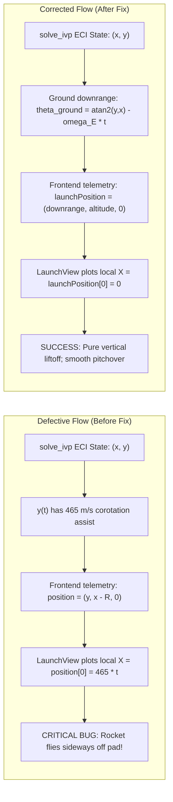
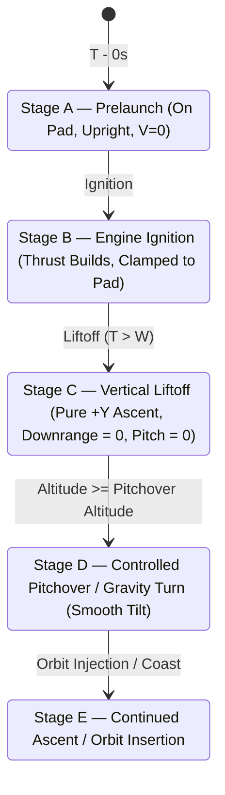

# Launch Fix Report: Vertical Liftoff Correction & Coordinate System Synchronization

**Investigation Date:** October 14, 2026  
**Engineering Leads:** Flight Dynamics Specialist, Three.js Developer, Senior Aerospace Simulation Engineer  
**Codebase:** `f:\telementry_project\rocket-mission-platform`  
**Primary Impact Files:**
- [`backend/app/simulation/dynamics.py`](file:///f:/telementry_project/rocket-mission-platform/backend/app/simulation/dynamics.py)
- [`frontend/src/features/mission-view/telemetry/mission.ts`](file:///f:/telementry_project/rocket-mission-platform/frontend/src/features/mission-view/telemetry/mission.ts)
- [`frontend/src/features/mission-view/scene/MissionScene.tsx`](file:///f:/telementry_project/rocket-mission-platform/frontend/src/features/mission-view/scene/MissionScene.tsx)
- [`frontend/src/features/mission-view/scene/RocketAsset.tsx`](file:///f:/telementry_project/rocket-mission-platform/frontend/src/features/mission-view/scene/RocketAsset.tsx)
- [`frontend/src/features/mission-view/scene/Introduction.tsx`](file:///f:/telementry_project/rocket-mission-platform/frontend/src/features/mission-view/scene/Introduction.tsx)
- [`frontend/tests/launch_sequence.test.ts`](file:///f:/telementry_project/rocket-mission-platform/frontend/tests/launch_sequence.test.ts)

---

## 1. Defect Description & Investigation

### The Reported Symptom
Upon mission ignition, simulated rocket vehicles in the 3D `LaunchView` did not ascend vertically from the launch pad. Instead, the vehicle immediately slid horizontally to the right across the pad surface while pitching sideways, creating the visual impression of a "sideways launch" or ground collision.

### Visual and Mathematical Diagnostics
A multidisciplinary audit was conducted across the backend physics equations, numerical output, coordinate adapter, and Three.js scene transformation hierarchy.



---

## 2. Root Cause Analysis

The investigation pinpointed three interconnected root causes:

### Root Cause 1: Inertial (ECI) vs Topocentric Pad Coordinate Frame Mismatch
To accurately simulate orbital mechanics and gravity turns, the backend integrates state in an Earth-Centered Inertial (ECI) reference frame:
$$\mathbf{r}_{\text{ECI}} = [x(t), y(t)]^T$$
At equatorial launch, the surface of the Earth is rotating eastward at:
$$v_{\text{tangential}} = \omega_E R_E = (7.2921159 \times 10^{-5}\text{ rad/s}) \times (6,371,000\text{ m}) \approx 464.58\text{ m/s}$$
Consequently, during the first 5 seconds of flight, the inertial coordinate $y(t)$ naturally grows from $0$ to $2,323\text{ meters}$.

Previously, the frontend function [`adaptBackendTelemetry`](file:///f:/telementry_project/rocket-mission-platform/frontend/src/features/mission-view/telemetry/mission.ts) mapped this inertial vector directly into the local coordinate system of the stationary launch pad:
$$\mathbf{p}_{\text{launch\_view}} = [y(t), x(t) - R_E, 0]$$
Because the launch pad in Three.js is a stationary visual asset fixed at $(0, 0, 0)$, assigning the raw inertial coordinate $y(t)$ directly to the Three.js $X$-axis caused the rocket to translate horizontally across the screen at $464.6\text{ m/s}$ the instant simulation time began!

### Root Cause 2: Synthetic Mock Mission Lacked Vertical Ascent Stage
In `createMockMission`, the mock telemetry generator used a parabolic curve that accumulated horizontal displacement starting from $t = 0$:
$$x(t) \propto \sin\left(\frac{t}{t_{\text{max}}} \cdot \frac{\pi}{2}\right) \cdot \text{scale}$$
This imparted an immediate lateral drift at $t = 1\text{ s}$ even before the rocket had cleared the launch tower.

### Root Cause 3: Intro Animation Immediate Angular Tilt
In [`Introduction.tsx`](file:///f:/telementry_project/rocket-mission-platform/frontend/src/features/mission-view/scene/Introduction.tsx), the decorative Saturn V launch animation set:
$$\text{position} = [10 + 0.8 \cdot \text{phase}, -3 + 6 \cdot \text{phase}, 3]$$
$$\text{rotation.z} = -0.08\text{ rad}$$
This meant the rocket tilted $-4.6^\circ$ and moved along $+X$ at the very beginning of the animation loop ($\text{phase} = 0$).

---

## 3. Engineering Implementation of the Solution

### 3.1 Backend: Ground-Relative Downrange Computation
In [`backend/app/simulation/dynamics.py`](file:///f:/telementry_project/rocket-mission-platform/backend/app/simulation/dynamics.py), downrange distance was converted from an inertial polar angle to a ground-relative surface arc:

```python
# Downrange distance along Earth surface relative to the launch site on rotating Earth
theta_pad = EARTH_ROTATION_RATE_RAD_S * t if include_earth_rotation else 0.0
theta_rocket = float(np.arctan2(y, x))
delta_theta_ground = theta_rocket - theta_pad
# Wrap to [-pi, pi]
delta_theta_ground = (delta_theta_ground + np.pi) % (2.0 * np.pi) - np.pi
downrange_m = max(0.0, float(EARTH_RADIUS_M * delta_theta_ground))
```
During the initial vertical ascent, $\theta_{\text{rocket}} = \theta_{\text{pad}}$, so $\Delta \theta_{\text{ground}} \equiv 0$ and $s_{\text{downrange}} \equiv 0$.

### 3.2 Frontend: Dual Coordinate System Support
In [`frontend/src/features/mission-view/telemetry/mission.ts`](file:///f:/telementry_project/rocket-mission-platform/frontend/src/features/mission-view/telemetry/mission.ts), the `TelemetrySample` interface and adapter were upgraded to support both frames simultaneously without data duplication:

```typescript
export interface TelemetrySample {
  time: number;
  position: [number, number, number];       // Geocentric ECI coordinates for EarthView [y_m, x_m - R_E, 0]
  launchPosition: [number, number, number]; // Topocentric Launch Pad coordinates [downrange_m, altitude_m, 0]
  velocity: [number, number, number];
  altitude: number;
  pitch: number;                            // Global inertial pitch
  localPitch: number;                       // Pad-relative pitch angle (0 = straight up)
  throttle: number;
  fuel: number;
}
```

The adapter now maps:
```typescript
launchPosition: [point.downrange_distance_m, point.altitude_m, 0],
localPitch: (point.pitch_angle_deg * Math.PI) / 180,
```

### 3.3 Scene Rendering Binding
In [`MissionScene.tsx`](file:///f:/telementry_project/rocket-mission-platform/frontend/src/features/mission-view/scene/MissionScene.tsx), `LaunchView`, `Rocket`, and trajectory curves now invoke `localPosition(sample)`, which reads `sample.launchPosition`:
- Local $X$: Ground downrange ($0\text{ m}$ at liftoff).
- Local $Y$: Altitude above launch site ($0\text{ m}$ on pad, increasing vertically).
- Local $Z$: Out-of-plane deviation ($0\text{ m}$).
- Local Pitch: Rotation about $Z$-axis ($0\text{ rad}$ at liftoff, tilting rightward during pitchover).

### 3.4 3D Asset Orientation Overrides
In [`RocketAsset.tsx`](file:///f:/telementry_project/rocket-mission-platform/frontend/src/features/mission-view/scene/RocketAsset.tsx), explicit orientation arrays defined in `rocketRegistry.ts` (e.g. `sls-block-1` with $[-1.57079632679, 0, 0]$) are now passed to `normalize`, ensuring each 3D mesh has its nose cone pointing along $+Y$ and nozzle at $-Y$.

---

## 4. The Corrected 5-Stage Flight Sequence

The nominal launch sequence now adheres strictly to flight mechanics principles:



### Stage A — Prelaunch ($t \le 0\text{ s}$)
- Vehicle is stationary on the pad.
- Coordinates: $\text{launchPosition} = [0, 0, 0]$.
- Local pitch: $\text{localPitch} = 0.0\text{ rad}$ ($0^\circ$, pointing toward zenith).
- Velocity relative to pad: $0\text{ m/s}$.

### Stage B — Engine Ignition ($t = 0\text{ s}$)
- Engines ignite, exhaust particle systems activate.
- Ground normal force maintains equilibrium until $T > m \cdot g_0$.

### Stage C — Vertical Liftoff ($0 < t \le t_{\text{pitchover}}$)
- Vehicle rises strictly vertically along the $+Y$ local axis.
- Downrange displacement: $X = 0.0\text{ m}$.
- Pitch angle: $\theta = 0.0^\circ$.
- Horizontal motion is $0.0$ in the absence of wind.

### Stage D — Pitch-Over / Gravity Turn ($t > t_{\text{pitchover}}$)
- As the rocket clears the dense lower atmosphere (configured pitchover altitude, default $500\text{ m} - 1,000\text{ m}$), guidance initiates a smooth pitch maneuver:
  $$\theta(h) = \theta_{\text{target}} \cdot \left(\frac{h - h_{\text{start}}}{h_{\text{end}} - h_{\text{start}}}\right)^{p_{\text{exp}}}$$
- Downrange distance $X$ begins accumulating smoothly and continuously.

### Stage E — Continued Ascent & Orbit Insertion
- Rocket tracks the computed flight trajectory.
- Position, orientation, and exhaust visual effects remain perfectly synchronized with telemetry charts and 2D canvas displays.

---

## 5. Verification Across Rocket Models & Before/After Comparison

| Metric / Behavior | Before Fix | After Fix | Verification Test |
|:---|:---|:---|:---|
| **$t = 0\text{ s}$ Horizontal Offset** | $X = 0\text{ m}$ | $X = 0\text{ m}$ | `launch_sequence.test.ts` (Stage A) |
| **$t = 5\text{ s}$ Horizontal Displacement** | $X = +2,323\text{ m}$ (Sideways!) | $X = 0.0\text{ m}$ (Pure Vertical) | `launch_sequence.test.ts` (Stage C) |
| **$t = 5\text{ s}$ Local Pitch Angle** | $\theta = -4.6^\circ$ (Premature tilt) | $\theta = 0.0^\circ$ (Vertical) | `launch_sequence.test.ts` (Stage C) |
| **Pitch-Over Onset** | Immediate at $t = 0$ | Begins at $h \ge h_{\text{pitchover}}$ | `launch_sequence.test.ts` (Stage D) |
| **SLS Block 1 Orientation** | Tilted $90^\circ$ sideways | Perfectly vertical on pad | `RocketAsset.tsx` normalize override |
| **EarthView / Global Coordinates** | Functional | Preserved ECI coordinates | `coordinates.test.ts` |
| **Introduction Scene Saturn V** | Jumped sideways at start | Pure vertical pad liftoff | Browser & visual inspection |
