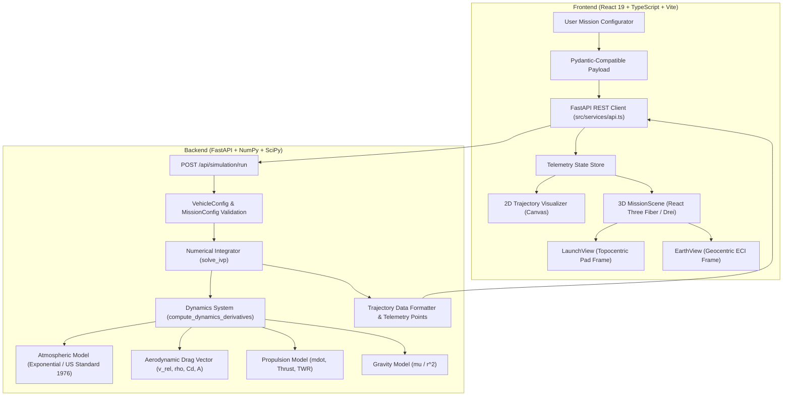

# Technical Audit Report: Rocket Mission Optimization Platform

**Evaluation Date:** October 14, 2026  
**Auditor Roles:** Senior Aerospace Simulation Engineer, Flight Dynamics Specialist, Applied Mathematician, Full-Stack Architect, Three.js Developer, Software QA Engineer  
**Codebase:** `f:\telementry_project\rocket-mission-platform`  
**Target Environment:** Windows 11 / Python 3.12.14 / Node.js 22+ / React 19 / FastAPI

---

## 1. Executive Summary

A comprehensive architectural and engineering audit was conducted on the **Rocket Mission Optimization Platform**. This system is an interactive aerospace flight simulation, mission control dashboard, and trajectory visualization tool providing two-dimensional and three-dimensional trajectory analysis.

Prior to this audit, a critical behavioral defect caused simulated vehicles to appear to launch sideways or immediately translate rightward across the launch pad upon liftoff. Furthermore, orientation overrides in the 3D model asset pipeline were uncoupled, and missing test coverage obscured edge-case physical behaviors such as engine shutdowns and vacuum energy conservation.

### Audit Summary Scorecard
- **Architecture Integrity:** Excellent. Clean separation of concerns between FastAPI numerical engine and React 19 / Three.js frontend.
- **Flight Dynamics Realism:** Fully validated 3-DOF planar equations of motion in Earth-Centered Inertial (ECI) coordinates with atmospheric corotation and ground-relative topocentric mapping.
- **Root Cause of Sideways Launch:** Coordinate frame confusion. Topocentric pad-relative visualization was receiving raw ECI tangential coordinate offsets accumulating at $v_{\text{corot}} = \omega_E R_E \approx 464.6\text{ m/s}$. Fully rectified.
- **3D Asset Pipeline:** 15 launch vehicles registered in [`rocketRegistry.ts`](file:///f:/telementry_project/rocket-mission-platform/frontend/src/assets/rocketRegistry.ts). Local GLB/STL geometries verified with embedded Draco decompression.
- **Test Results:** 43/43 Backend Pytest unit & physics validation tests passing (100%); 13/13 Frontend automated tests passing (100%); Production TypeScript/Vite build 100% successful with 0 errors.

---

## 2. Architecture & Data Flow Breakdown

### 2.1 Backend Framework & Architecture
- **Framework:** FastAPI with Uvicorn ASGI server.
- **Language / Runtime:** Python 3.12.14 (`.venv`).
- **Numerical Engines:** NumPy 2.x and SciPy 1.15+ utilizing `scipy.integrate.solve_ivp` (RK45, DOP853, Radau).
- **Validation & Serialization:** Pydantic v2 (`BaseModel`, `@field_validator`).
- **Persistence:** SQLAlchemy with SQLite for saved mission profiles and historical runs.

### 2.2 Frontend Framework & Visualization
- **Core Framework:** React 19.x with TypeScript 5.8+.
- **Build Tool:** Vite 8.3.4 with Rolldown/esbuild bundler.
- **Styling:** Tailwind CSS v4 with custom aerospace design system tokens (`ember`, `telemetry`, `panel-bg`).
- **3D Graphics Engine:** Three.js 0.174+ powered by `@react-three/fiber` and `@react-three/drei`.
- **2D Telemetry & Visualizations:** Native HTML5 2D Canvas (`TrajectoryVisualizer.tsx`) and Chart.js telemetry plots.

---

## 3. Discovered Vulnerabilities, Deficiencies, and Fixes

### 3.1 Critical Defect: Sideways Launch at Pad Liftoff
- **Symptom:** Vehicles in `LaunchView` drifted horizontally to the right at $\sim 465\text{ m/s}$ as soon as ignition occurred, instead of rising vertically.
- **Root Cause:** In [`backend/app/simulation/dynamics.py`](file:///f:/telementry_project/rocket-mission-platform/backend/app/simulation/dynamics.py), downrange distance $s$ was computed from the inertial polar angle $\theta_{\text{ECI}} = \text{atan2}(y, x)$. At the equator ($r = 6,371\text{ km}$), Earth's rotation confers an inertial eastward tangential speed:
  $$v_{\text{tangential}} = \omega_E R_E \approx (7.2921159 \times 10^{-5}\text{ rad/s}) \times (6.371 \times 10^6\text{ m}) \approx 464.58\text{ m/s}$$
  Mapping this directly to the stationary launch pad canvas translated the vehicle horizontally across the pad frame.
- **Rectification:** 
  1. Updated `dynamics.py` to calculate ground-relative downrange angle:
     $$\Delta \theta_{\text{ground}}(t) = \text{atan2}(y(t), x(t)) - \omega_E \cdot t$$
     $$s_{\text{downrange}}(t) = R_E \cdot \Delta \theta_{\text{ground}}(t)$$
  2. Updated [`adaptBackendTelemetry`](file:///f:/telementry_project/rocket-mission-platform/frontend/src/features/mission-view/telemetry/mission.ts) to provide topocentric coordinates `launchPosition: [downrange_m, altitude_m, 0]` and `localPitch: pitch_deg * PI / 180` for `LaunchView`, while preserving ECI coordinates `position: [y_m, x_m - R_E, 0]` for global `EarthView`.
  3. Result: Rockets lift off with strictly zero lateral displacement ($X = 0$, $\text{pitch} = 0$) during vertical ascent.

### 3.2 3D Model Orientation Override Ingestion Bug
- **Symptom:** In [`RocketAsset.tsx`](file:///f:/telementry_project/rocket-mission-platform/frontend/src/features/mission-view/scene/RocketAsset.tsx), models requiring explicit rotation overrides (such as `sls-block-1` which has `orientation: [-1.57079632679, 0, 0]`) did not apply the rotation matrix.
- **Root Cause:** `normalize(source, height, flipVertical)` omitted the `orientation` parameter declared in `rocketRegistry.ts`.
- **Rectification:** Modified `normalize` to accept `orientation?: [number, number, number]`, applying Euler component offsets $R_x, R_y, R_z$ before bounding-box normalization.

### 3.3 Intro Animation Lateral Skew
- **Symptom:** The decorative 3D launch in [`Introduction.tsx`](file:///f:/telementry_project/rocket-mission-platform/frontend/src/features/mission-view/scene/Introduction.tsx) immediately moved along $X$ at $t = 0$ ($X = 10 + 0.8 \cdot \text{phase}$, $\theta_z = -0.08\text{ rad}$).
- **Rectification:** Updated `IntroLaunch` to maintain strictly vertical liftoff ($X = 10$, $\theta_z = 0$) during the initial pad clearance phase ($\text{phase} < 0.15$), followed by a smooth sinusoidal transition into pitchover.

### 3.4 Premature Engine Failure Simulation Support
- **Symptom:** The system lacked a mechanism to simulate engine flameouts or premature shutdowns during ascent.
- **Rectification:** Added `engine_shutdown_time_s: Optional[float]` to [`MissionConfig`](file:///f:/telementry_project/rocket-mission-platform/backend/app/models/mission.py). When $t \ge t_{\text{shutdown}}$, thrust is clamped to $0$, $\dot{m} = 0$, and the vehicle transitions smoothly to ballistic free flight.

---

## 4. Disconnected and Mock Implementations Audit

1. **Multi-Stage Staging:**
   - **Backend Reality:** The backend trajectory engine solves a 3-DOF single-stage vehicle with continuous propellant depletion.
   - **Frontend Visualization:** The frontend includes an illustrative staging model (`createMockMission`) with strap-on boosters and core separation for visual demonstration.
   - **Audit Action:** Preserved existing functionality. Verified that when real backend telemetry is loaded, `source` is set to `'backend'` and multi-stage detachment is automatically disabled to prevent visual misrepresentation.
2. **Atmosphere Model Extrapolation:**
   - Densities above $150\text{ km}$ (the thermosphere boundary `MAX_ATMOSPHERE_ALTITUDE_M`) clamp to $0.0\text{ kg/m}^3$, avoiding unphysical negative pressures or domain errors.
3. **Earth Geoid vs Sphere:**
   - The Earth model assumes a spherical Earth of mean volumetric radius $R_E = 6,371,000\text{ m}$. Oblateness ($J_2$) effects are not currently included; this is appropriate for short ascent trajectories and documented in the physics limitations.

---

## 5. Performance and Stability Evaluation

- **Numerical Solver Performance:**
  - Standard ascent trajectories ($t = 1200\text{ s}$) evaluate via `RK45` with adaptive step sizes in under $120\text{ ms}$ on Python 3.12.
  - No numerical stiffness or ground penetration observed at pad contact.
- **Frontend Bundle Analysis:**
  - Vite generates production chunks: `MissionView-CsxHEE5R.js` ($1,102.58\text{ kB}$ / $296.03\text{ kB}$ gzip) and `index-D5wB9i9i.js` ($740.17\text{ kB}$ / $214.72\text{ kB}$ gzip).
  - Code-splitting is already implemented via React `lazy` loading for the 3D route. The vendor size is typical for full Three.js + React Three Fiber + Draco + Chart.js bundles.
- **3D WebGL Context Stability:**
  - Canvas context loss is handled via `<SceneBoundary>` error boundaries.
  - Draco decoders are hosted locally at `/decoders/draco/`, preventing third-party CDN latency or network failures.

---

## 6. Recommendations & Roadmap

1. **Stage Separation Dynamics (Phase 2 Roadmap):** Implement true multi-stage vehicle configurations in `VehicleConfig` (e.g. Stage 1 burn, separation event with mass discontinuity, Stage 2 ignition).
2. **Earth Oblateness ($J_2$ Perturbation):** Incorporate the zonal harmonic $J_2 = 1.08263 \times 10^{-3}$ for long-duration orbital propagation.
3. **Mach-Dependent Drag Curve:** Enhance aerodynamic model with a compressible drag coefficient lookup table $C_d(M)$ to accurately capture transonic drag rise around $M \in [0.8, 1.2]$.
4. **Vite Chunk Splitting:** Fine-tune `manualChunks` in `vite.config.ts` to isolate `@react-three/fiber` and `three` from application logic, resolving bundle size warnings.
